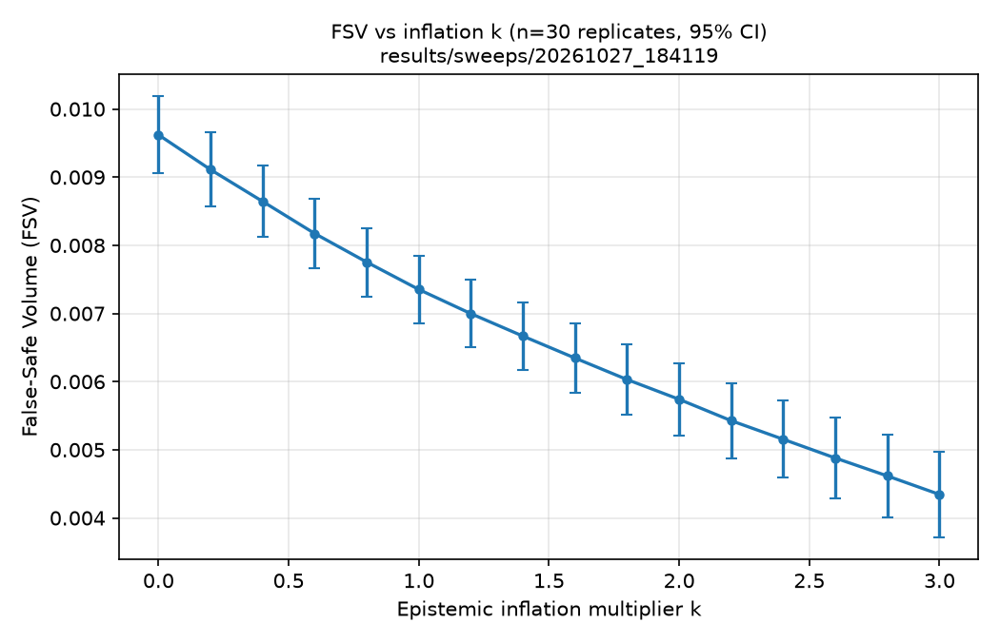
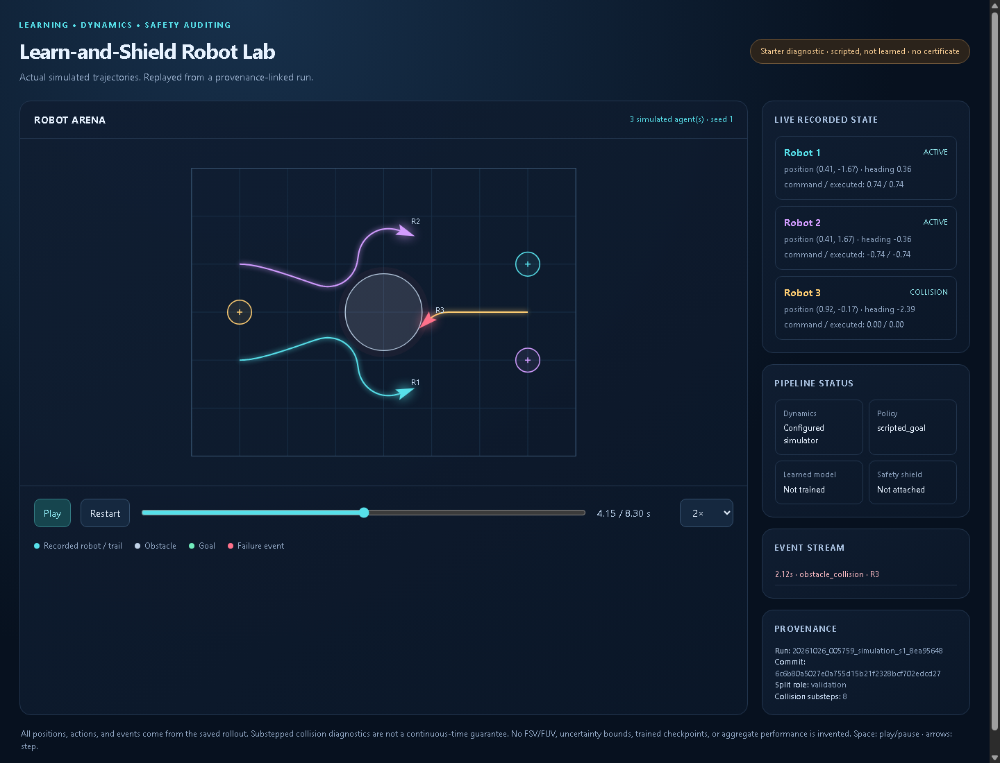

<div align="center">

# 🛡️ falsesafe-bench

**False-safe** means a robot's learned dynamics model says a state is recoverable (safe) when,
under the real physics, it is already too late to avoid a crash — and this benchmark measures how
large that wrongly-certified region is when dynamics are learned from finite data.

[](https://nisaral.github.io/falsesafe-bench/) [](https://nisaral.github.io/falsesafe-bench/viewer3d/) [](https://nisaral.github.io/falsesafe-bench/gym/)

**New here?** Robots that *learn* their own safety checks can wrongly say "safe" in places they never saw. FalseSafe-Bench measures how often and how badly. Start with the [interactive gym](https://nisaral.github.io/falsesafe-bench/gym/) (guided tour included) or the [plain-language glossary](https://nisaral.github.io/falsesafe-bench/glossary.html).


### Measuring How Wrong "Safe" Can Be — When Robots Learn Their Own Physics

[](https://github.com/nisaral/falsesafe-bench/actions/workflows/ci.yml)
[](LICENSE)
[](https://www.python.org/downloads/)
[](#status)

**A benchmark for measuring false-safe errors in Hamilton-Jacobi reachability when dynamics are learned from finite data.**

[Quick Start](#quick-start) · [What This Does](#what-this-does) · [Experiments](#experiments) · [Contributing](#contributing--help-wanted) · [Roadmap](#roadmap)

</div>

---

## Headline result

On the double integrator with a hidden-physics coverage gap, inflating the disturbance set by
`k=2.0` times the ensemble epistemic std reduces the False-Safe Volume by **40.34%**
(95% CI **[36.47%, 44.73%]**, n=30 replicates). The pre-registered bar was a **50%** reduction,
so the primary hypothesis H2 is **partially supported**: the effect is real and clearly above
zero, but smaller than claimed. Source: claim P1 in [`claims_ledger.md`](claims_ledger.md).



*FSV falls monotonically with k but flattens well above zero; figure regenerated from stored
results by `scripts/make_figures.py`.*

## What this repo is and is not

**Is:** a research harness for auditing Hamilton-Jacobi-reachability safety certificates under
learned dynamics — it computes a ground-truth BRT and a learned-model BRT on the same grid and
measures False-Safe Volume (FSV), False-Unsafe Volume (FUV) and IoU between them.

**Is not:** an LLM evaluation, a safety-certification product, or a finished benchmark. The
latent world-model path is exploratory and its gates have not passed; the Dubins experiments
E1–E3 have not been run. Only the double-integrator results in `results/` are reported claims.

## What This Does

When a robot learns a model of how it moves from data, it can compute a **safe set** — states where it's guaranteed not to crash. But what happens when the learned model is wrong?

**falsesafe-bench** measures exactly that:

```
                    True Safe Set          Learned Safe Set
                   ┌─────────────┐       ┌──────────────────┐
                   │             │       │  FALSE-SAFE ⚠️    │
                   │   ACTUALLY  │       │  (Model says safe │
                   │    SAFE     │       │   but it's NOT)   │
                   │             │       │                   │
                   └─────────────┘       └──────────────────┘
```

The **false-safe volume** is the most dangerous error in safety-critical systems: states where your learned model confidently says "go ahead, it's safe" — but it isn't.

### Key Questions

| # | Hypothesis | Status |
|---|---|---|
| H1 | Learned-model safe sets have false-safe volume that grows in coverage gaps | 🔬 Testing |
| H2 | Epistemic uncertainty inflation reduces false-safe volume by ≥50% | 🔬 Testing |
| H3 | Inflation has a conservatism cost (false-unsafe volume rises) | 🔬 Testing |
| H4 | Separating epistemic and aleatoric uncertainty beats a blended statistic | 🔬 Testing |
| H5 | QRE inverse games exhibit the predicted scale ambiguity | 📋 Planned |

## Status

**Research in progress.** What exists today (2026-10-30):

- **Double integrator (DI), done as pilot/primary runs:** MLP-ensemble dynamics learned from data with a
  coverage gap, learned-model HJ backward reachable tube (`hj_learned.py`), FSV/FUV metrics with
  bootstrap CIs (`metrics.py`), and six certifiers compared (`certifiers/`). Every number is in
  [`claims_ledger.md`](claims_ledger.md) with run ids and commits. Headline (claim P1, n=30 replicates):
  epistemic inflation at k=2 cut false-safe volume by 40.3% [36.5%, 44.7%], which **does not meet**
  the pre-registered ≥50% bar for H2. The n=30 are replicates (initialization/noise/bootstrap seeds);
  the data split is fixed at `split_seed=42`, so these CIs reflect model and noise variability only
  and thus understate data-sampling variability.
- **Dubins car:** ground-truth HJ solver and learned-model code exist; the Dubins experiments (incl. H4) are not run yet.
- **Simulator demos:** seeded scripted-controller replays only. No RL policy has been trained and
  no learned safety filter drives the browser demos.



*Midpoint screenshot of the seeded fleet diagnostic, including its recorded failure. This is not a successful-learning or safety result.*

## Repo map

| Path | What it holds |
|---|---|
| `src/lcert/metrics.py` | Protected FSV / FUV / IoU / Gap-FSV and bootstrap CIs |
| `src/lcert/hj_di.py`, `hj_learned.py` | True and learned-model HJ reachability (double integrator) |
| `src/lcert/certifiers/` | Conformal (C0/C1a/C1b/C2) and distance-aware (L) certifiers |
| `src/lcert/models/` | MLP ensembles and Gaussian-process dynamics models |
| `src/lcert/framework/` | Exploratory plug-in harness (env/hazard/policy/certifier) |
| `scripts/` | Entry points: `run_experiment.py`, `run_pipeline.py`, `validate_runlogs.py`, `make_figures.py` |
| `configs/` | Experiment configs; the two legacy configs pin `border_cells: 2` |
| `tests/` | Protected pytest suite (100 passed, 2 skipped) |
| `results/` | Frozen legacy baseline (see `results/README.md`) |
| `docs/` | Report, framework docs, known issues, figures |
| `SCOPE.md`, `claims_ledger.md` | Binding integrity contract and every reportable number |

## Architecture

```
falsesafe-bench/
├── src/lcert/              # Core library
│   ├── systems.py          # Double integrator & Dubins dynamics
│   ├── hj_di.py            # HJ reachability for double integrator
│   ├── hj_dubins.py        # HJ reachability for Dubins car
│   ├── hj_learned.py       # HJ reachability on a learned (ensemble) DI model
│   ├── metrics.py          # FSV / FUV / IoU, bootstrap CIs
│   ├── certifiers/         # Conformal, distance-aware, Pareto (AUPC) comparison
│   ├── data.py             # Trajectory data collection with coverage gaps
│   ├── models/             # MLP ensembles & Gaussian Processes
│   ├── envs/               # Dubins arena & fleet simulation
│   ├── rl/                 # RL loss functions (REINFORCE, A2C, PPO, DPO, GRPO) + small actor-critic; no training loop yet
│   ├── population/         # Toy entropic OT, discrete bridge, mean-field congestion game
│   ├── games/              # Logit QRE solver (inverse games not implemented)
│   ├── constraints/        # Physics & geometry constraints
│   └── visualization/      # Browser replay generation
├── configs/                # Experiment configurations (immutable after use)
├── scripts/                # Entry points & utilities
├── tests/                  # Sanity tests (protected)
├── demos/                  # Browser-based replay viewer
└── results/                # Logged runs with full provenance
```

## Tech Stack

| Component | Technology |
|---|---|
| HJ Solver | [hj_reachability](https://github.com/StanfordASL/hj_reachability) (JAX) |
| Dynamics Learning | PyTorch (MLP ensembles) + GPyTorch (Gaussian Processes) |
| RL | PyTorch loss functions only (PPO, A2C, REINFORCE, DPO/GRPO) |
| Optimal Transport | [POT](https://pythonot.github.io/) |
| Visualization | Matplotlib + standalone HTML5 Canvas |
| Numerics | NumPy, SciPy, JAX |
| Runtime | Python 3.13, managed by [uv](https://github.com/astral-sh/uv) |

## Quick Start

```bash
git clone https://github.com/ManavJobanputra/falsesafe-bench.git && cd falsesafe-bench
uv venv --python 3.13 && source .venv/bin/activate && uv pip install -r requirements.txt
python scripts/run_experiment.py doctor
python -m pytest -q -p no:cacheprovider
PYTHONPATH=src python -m lcert.framework run configs/framework/di_nominal_sweep.yaml
```

The last command runs an exploratory framework sweep and writes JSON for the offline 3D viewer
(`demos/viewer3d/index.html`). It is not the preregistered P1 experiment.

### Platform-specific setup

#### Windows

```powershell
git clone https://github.com/ManavJobanputra/falsesafe-bench.git
cd falsesafe-bench
.\scripts\bootstrap.ps1

# Verify the installation
.\.venv\Scripts\python.exe scripts/run_experiment.py doctor
.\.venv\Scripts\python.exe -m pytest -q -p no:cacheprovider

# Run a single robot simulation
.\.venv\Scripts\python.exe scripts/run_experiment.py simulate --config configs/starters/single_robot.json

# Run a fleet simulation
.\.venv\Scripts\python.exe scripts/run_experiment.py simulate --config configs/starters/fleet.json
```

#### Linux / macOS

```bash
git clone https://github.com/ManavJobanputra/falsesafe-bench.git
cd falsesafe-bench

# Install uv if not present
curl -LsSf https://astral.sh/uv/install.sh | sh

# Bootstrap
uv python install 3.13
uv venv --python 3.13
source .venv/bin/activate
uv pip install -r requirements.txt

# Verify & run
python scripts/run_experiment.py doctor
python -m pytest -q -p no:cacheprovider
python scripts/run_experiment.py simulate --config configs/starters/single_robot.json
```

Open the printed run folder's `demo.html` in a browser. It works without a server or frontend dependencies.

## Experiments

| ID | What | System | Status |
|---|---|---|---|
| E0 | Ground-truth BRT vs analytic | Double Integrator | ✅ Passing |
| E1 | FSV vs data size, gap vs no-gap | DI + Dubins | 🔬 DI pilot + primary cell run (`results/`); size ladder and Dubins not run |
| E2 | Epistemic inflation tradeoff | DI + Dubins | 🔬 DI run (claims P1, S1); Dubins not run |
| E3 | Separated vs blended uncertainty | DI + Dubins | 🔬 Planned |
| E4 | Fleet pairwise safety | 3 Dubins | 📋 Extension |
| E5 | QRE inverse games | 2×2 / 3×3 | 📋 Extension |
| E6 | Learning robot with HJ shield | Dubins | 📋 Extension |
| E7 | Multi-agent fleet learning | 3 Dubins | 📋 Extension |
| E8-E12 | Population, physics, swarms | Various | 📋 Future |

## Limitations

See [`docs/KNOWN_ISSUES.md`](docs/KNOWN_ISSUES.md) for the verified list. In brief: FSV is a
grid-cell count, so small disturbance changes can be invisible; the committed results used a
2-cell evaluation border while SCOPE specifies 3; the n=30 replicates share a fixed data split
(`split_seed=42`), so their CIs understate data-sampling variability; C0 and C2 are bit-identical
in the stored S2 output; and framework numbers are not comparable to `results/` numbers.

## Integrity

Every number in this repo is traceable:
- **No fabricated results.** If a metric isn't computed, it says so.
- **New runs must be logged** with seeds, git commit, configs, and artifact hashes, per
  `runlog_schema.json`. The committed legacy runlogs predate this and do **not** satisfy the schema;
  `scripts/validate_runlogs.py` reports which fields are missing (see `results/README.md`).
- **Negative results** are reported with the same prominence as positive ones.
- **claims_ledger.md** tracks every number that leaves this repo.

See [SCOPE.md](SCOPE.md) for the full integrity contract and [PLAN.md](PLAN.md) for the research plan.

## Contributing / Help wanted

We welcome contributions! Areas where help is especially valuable:

- 🤖 **New robot environments** (quadrotors, car-like vehicles, manipulators)
- 🧠 **Dynamics learning methods** (transformers, neural ODEs, conformal prediction)
- 🛡️ **Safety methods** (CBFs, MPC, alternative reachability solvers)
- 📊 **Benchmarking** (running experiments on new systems, comparing methods)
- 📖 **Documentation** (tutorials, notebooks, examples)

Starter tasks are labelled [good first issue](https://github.com/nisaral/falsesafe-bench/issues?q=is%3Aissue+is%3Aopen+label%3A%22good+first+issue%22) and [help wanted](https://github.com/nisaral/falsesafe-bench/issues?q=is%3Aissue+is%3Aopen+label%3A%22help+wanted%22). Please read [CONTRIBUTING.md](CONTRIBUTING.md) before submitting PRs.

## Roadmap

- [x] Simulation engine with deterministic replay
- [x] HJ reachability on double integrator (analytic match)
- [x] Browser-based fleet replay viewer
- [x] RL loss-function primitives
- [x] `metrics.py` — FSV/FUV/IoU computation pipeline
- [x] Learned dynamics models (MLP ensembles used in DI runs; GP code present, no GP result in claims_ledger.md yet)
- [ ] Core experiments E1-E3 (DI partly done; Dubins pending)
- [ ] Safety filter integration
- [ ] Robot RL with shielding
- [ ] Gymnasium-compatible environments
- [ ] Interactive Colab notebooks
- [ ] Documentation site

## Origin and attribution

This repository began as a fork of [nisaral/falsesafe-bench](https://github.com/nisaral/falsesafe-bench)
(upstream commit `a4fd856`). Changes since then are listed in [CHANGELOG.md](CHANGELOG.md).
Upstream authorship and the Apache-2.0 license are preserved unchanged.

## Citation

If you use this work, please cite:

```bibtex
@software{falsesafe_bench,
  author = {Nisar, Keyush},
  title = {falsesafe-bench: Measuring False-Safe Errors in Hamilton-Jacobi Reachability Under Learned Dynamics},
  year = {2026},
  url = {https://github.com/nisaral/falsesafe-bench}
}
```

## License

This project is licensed under the Apache License 2.0 — see [LICENSE](LICENSE) for details.

---

<div align="center">

**⚠️ This is a research tool, not a safety certification system. A collision-free simulation replay is not a safety guarantee.**

</div>


## Framework + 3D viewer (exploratory)

Build your own dynamics/hazard/policy/certifier and evaluate it against HJ ground truth with FSV/FUV/gap-FSV: see [docs/FRAMEWORK.md](docs/FRAMEWORK.md). View results in 3D: open `demos/viewer3d/index.html` (offline). Framework numbers are exploratory, not preregistered results.

**Learned-from-pixels (world model) panel.** Both demos have a *World model* button (press `W` in the 3D viewer). It compares the exact safe set with the one a camera-trained world model believes, highlights the false-safe regions in red, and splits the error into encoder, dynamics and margin parts. These are dev-seed, exploratory numbers whose gates have **not** passed, so they show where the model fails, not that it works. See [docs/WORLDMODEL_DEMO.md](docs/WORLDMODEL_DEMO.md).

**Demo extras:** a *Start here* card, keyboard help (`H` or `?`), shareable links (`U` copies a link that restores the current view), *Compare side by side* in the gym (`V`), and a plain-language *What just happened* log.

**Gym insight tools:** a *timeline* of V_true vs V̂ for each episode (false-safe stretches shaded; drag or `[`/`]` to rewind), a clickable state-space map (hover for values, click to start an episode at that state), a *danger vs. caution* chart of every certifier's FSV/FUV from the Python export (whole map or gap only), and an exploratory shield trigger-margin slider. In-browser numbers stay exploratory; FSV/FUV come from Python.

**World Models / CarRacing.** Ha & Schmidhuber 2018 trained a controller *inside a pixel world model*. This project uses that stack to *grade* the dream's safety certificate. The gym scenario `track_ice` is CarRacing-v0 reduced to a 3D Dubins ring with a hidden ice corner so false-safe volume is exact HJ. Box2D 64×64 CarRacing and Dreamer-style walkers exceed the 3D grid-solver limit in SCOPE.md; they are not confirmatory environments.
