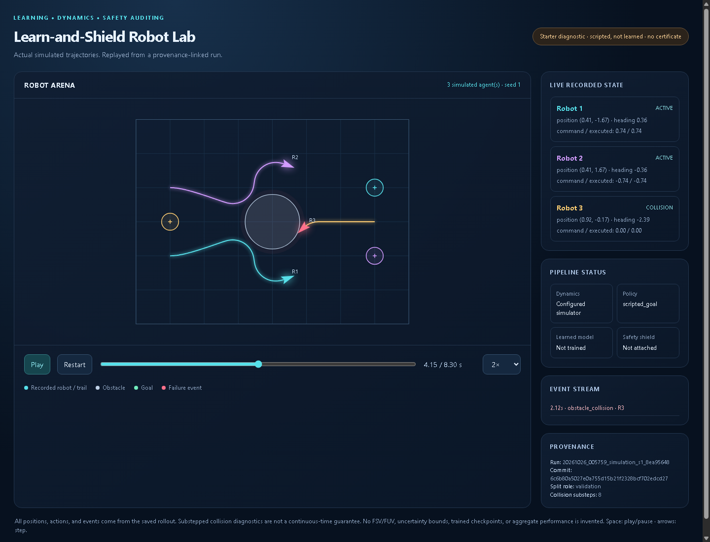

# Learn-and-Shield Robot Lab

Learn dynamics, policies, population flows, and incentives from simulated behaviour, then audit learned-model safety with Hamilton-Jacobi reachability. The scientific question is false-safe error under finite data and coverage gaps, not whether a convincing animation looks safe.

**Status: functional starter, not completed research.** The current demos use real, seeded simulator trajectories with scripted controllers. No dynamics model or RL policy has been trained, no learned-model safety filter is attached, and no benchmark result or unconditional safety guarantee is claimed.



Actual midpoint screenshot of the seeded fleet diagnostic, including its recorded failure. `demos/preview_manifest.json` links the source commit, config, run and hashes. This preview is not a successful-learning or safety result; the full replay preserves later domain exits too.

## Available now

| Track | Implemented starter | Still gated or planned |
|---|---|---|
| Robot simulation | Single/fleet Dubins arena, bounded commands, terminal events, deterministic replay | Trained controllers, reviewed rewards, safety-filter integration |
| Presentation | Standalone dark Canvas replay, trails, timeline/speed controls, events and provenance | Learned uncertainty/safety overlays and checkpoint comparisons |
| Dynamics | Seeded trajectory splits, coverage gaps, synthetic derivative-observation noise, GP/MLP ensemble classes | Recovery/shuffled-label checks and trained-model evaluation |
| Reachability | True-dynamics DI/Dubins BRT snapshots; raw-artifact plotting | Dubins refinement, protected metrics, learned-dynamics HJ |
| Robot learning | REINFORCE/A2C/PPO, robot DPO/GRPO-style objectives, BC, IQL expectile loss, actor-critic, replay buffer | Complete trainers, SAC/TD3/CQL, MAPPO/independent PPO comparisons |
| Populations/games | Entropic OT, finite-state Markov-reference bridge, toy congestion MFG, logit QRE and seeded play | Held-out studies, inverse-game estimator, population demos |
| Geometry/physics | Body-frame transforms and a public fixed-speed kinematic prior | Matched-data geometric/PINN ablations |

E0-E12 are registered with explicit readiness and blockers. Only E0 ground-truth diagnostics, scripted simulations, and data generation are runnable; naming an algorithm or experiment does not implement a full trainer or evaluator.

## Quick start on Windows

Run from this repository's root. Prerequisites: Git and `uv`; the bootstrap provisions project-local Python 3.13 and installs the existing pinned `requirements.txt` without changing it.

```powershell
.\scripts\bootstrap.ps1
.\.venv\Scripts\python.exe scripts/run_experiment.py doctor
.\.venv\Scripts\python.exe scripts/check_scaffold.py
.\.venv\Scripts\python.exe -m pytest -q -p no:cacheprovider
.\.venv\Scripts\python.exe scripts/run_experiment.py simulate --config configs/starters/single_robot.json
.\.venv\Scripts\python.exe scripts/run_experiment.py simulate --config configs/starters/fleet.json
```

Open the printed run folder's `demo.html` in a browser. It works without a server or frontend dependencies. The badge explicitly says **scripted, not learned, no certificate**. See `START_HERE.md` for data, ground-truth, plotting, Linux/macOS setup, and next implementation steps.

Run recording requires a committed, clean **project-local** Git tree. Commit config changes before running; never modify a config after it has been used. Config copies, seeds, commit, library/hardware information, stdout, artifact hashes, and failures live under `results/runs/<run_id>/`. Generated data, runs, figures, environments, secrets, and checkpoints are Git-ignored; no large artifacts or credentials are pushed.

## Research and integrity

Keep the W1-W4 scientific MVR first. Human-reviewed metrics and core/model checks precede reported studies; MVR sign-off precedes robot RL training, then fleet work. All remaining extensions have separately reviewed protocols and budgets.

- `SCOPE.md`, `AGENTS.md`, `CLAUDE.md`: binding contract; protected tests and metrics are untouched.
- `PLAN.md`: hypotheses, E0-E12 questions, sequencing and delivery gates.
- `ALGORITHMS.md`: algorithm/data contracts and primary references, including robot-action DPO/GRPO adaptations.
- `SIMULATION_DEMOS.md`: current replay and planned flagship features, evidence requirements.
- `claims_ledger.md`: every externally reported research number; currently no result claims.

`make starter` runs checks and starter diagnostics when GNU Make and the pinned environment are available. `make reproduce` deliberately fails until the reviewed scientific reproduction exists; a few diagnostics are not a completed E1-E12 study. A single collision-free replay, model spread, transport interpolation, or pairwise shield is not a global safety certificate.
